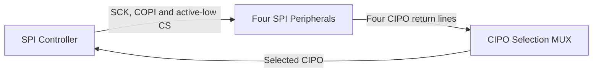

# SPI Design and Physical Implementation

**Academic Project | Electronic IC Design Practice | University of Science, VNU-HCM | 2026**

An academic Serial Peripheral Interface (SPI) design project covering **SystemVerilog RTL design, functional verification, and the full RTL-to-layout physical design flow** using **OpenLane 2** and the **SkyWater 130 nm** technology.

> **Repository status:** Documentation only. This repository is intended to share the project report and presentation PDFs; standalone RTL source files, testbench, and OpenLane configuration/scripts are not included. Add the presentation file at the path listed below before publishing. The implementation and results below are documented in the report.

## Project Overview

The system connects **one SPI Controller to four SPI Peripherals**. Each transaction selects one Peripheral using an active-low chip-select signal, then:

1. Transfers 8 bits from the Controller to the selected Peripheral over **COPI** (LSB first).
2. Waits for a configurable **PAUSE** interval.
3. Transfers 8 bits from the selected Peripheral back to the Controller over **CIPO** (LSB first).

The design also handles active-low reset, ignores new transfer requests while busy, and prevents repeated transfers when the start signal remains high.

### Architecture

## Design and Verification

- **RTL:** Parameterized SystemVerilog modules for the top-level, SPI Controller, and SPI Peripheral.
- **Functional verification:** Self-checking testbench with 9 test scenarios, including Peripheral selection, two-way transfers, consecutive transactions, busy-state requests, held-high start, and reset during transfer.
- **Physical implementation:** Full flow through synthesis, floorplanning, placement, clock tree synthesis, routing, and signoff with OpenLane 2 on SkyWater 130 nm.
- **Post-layout verification:** Functional behavior remained consistent with RTL simulation.

## Key Results

| Metric | Reported result |
| --- | --- |
| Clock target | **50 MHz** (20 ns period) |
| Functional checks | **27/27 PASS**, 0 FAIL |
| Post-route setup slack | **+3.2264 ns** |
| Post-route hold slack | **+0.1095 ns** |
| DRC | **0 violations** |
| LVS | **Matched** |
| Antenna checks | **0 violations** |
| Post-layout functional verification | **PASS** |

**Note:** 50 MHz is the timing target met by this implementation, **not a measured maximum operating frequency (Fmax)**. The project is a specified educational SPI design, not a claim of support for every standard SPI operating mode or silicon tape-out.

## Documentation

- [Full Project Report (PDF)](docs/SPI_Project_Report.pdf)
- [Project Presentation (PDF)](docs/SPI_Presentation.pdf)

The report contains the architecture, specifications, RTL and testbench excerpts, physical design results, signoff checks, and post-layout simulation results.

## Tools and Technology

- **HDL:** SystemVerilog
- **Physical design:** OpenLane 2
- **PDK / standard-cell library:** SkyWater 130 nm (`sky130_fd_sc_hd`)
- **Report-backed verification:** Self-checking SystemVerilog testbench

## Contributors

Developed as a team project for the Electronic IC Design Practice course at the University of Science, VNU-HCM (2026). See the project report for the team credits.
